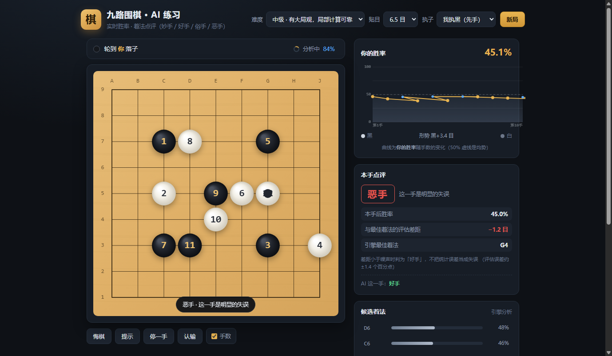

# 九路围棋 · AI 练习

一个纯前端的九路围棋（9×9）练习网站：内置蒙特卡洛 AI 对手、可调难度、实时胜率曲线，
并且在你落子后给出**着法点评（妙手 / 好手 / 普通 / 俗手 / 恶手）**。

无构建步骤、无外部依赖，打开 `index.html` 即可运行。

```bash
node server.mjs 8123      # 然后访问 http://127.0.0.1:8123/
```



---

## 桌面版与安装包

仓库自带打包工程，两条路都通：

**① GitHub Actions 在线打包（推荐）**——推 tag 即自动产出并挂到 Release：

```bash
git tag v1.0.0 && git push --tags      # 触发构建 → 自动创建 Release
```

> 注意：用 OAuth App 推送 `.github/workflows/` 需要额外的 `workflow` 权限，
> `gh auth refresh -h github.com -s workflow` 授权一次即可。
> 如果拿不到该权限，也可以直接在 GitHub 网页编辑器里新建
> `.github/workflows/build.yml`（内容即仓库里那份）。

**② 本地构建**（需要对应工具链）：

```bash
# Windows：.NET 8 SDK
cd desktop/windows
# 先把仓库根目录的 index.html / styles.css / js/ 复制到 www/
dotnet publish Go9.csproj -c Release -r win-x64 --self-contained -p:PublishSingleFile=true -o out

# Android：脚本会自动拉取 JDK 17 + Android SDK + Gradle（缓存在 .build/）
powershell -ExecutionPolicy Bypass -File scripts/build-apk.ps1

# 发布到 GitHub Release
powershell -ExecutionPolicy Bypass -File scripts/publish-release.ps1 v1.0.0
```

| 产物 | 平台 | 说明 |
|---|---|---|
| `Go9.exe` | Windows 10/11 | .NET 8 + WebView2 壳（单文件 ~63 MB，网页资源内嵌在 exe 里；需系统自带 Edge WebView2 Runtime） |
| `app-debug.apk` | Android 7+ | WebView 壳（Gradle `assembleDebug`，debug 签名，装前需允许「未知来源」） |

---

## 功能

| 功能 | 说明 |
|---|---|
| 9×9 棋盘 | 中国规则、面积计子、禁自杀、简单劫 + 位置超级劫 |
| AI 对手 | 5 档难度（入门 / 初级 / 中级 / 高级 / 大师），由模拟预算、选点温度与失误率共同控制 |
| 胜率曲线 | 每手之后重新评估局面，绘制黑方胜率随手数变化的曲线，并给出当前胜率与形势目数 |
| 着法点评 | 每手落子后给出「妙手 / 好手 / 普通 / 俗手 / 恶手」＋胜率损失＋引擎推荐着法 |
| 候选着法 | 引擎评估后的前 6 个候选着法及各自胜率（列表，不在棋盘上画标记，避免闪动） |
| 辅助功能 | 悔棋、提示（棋盘上标一个圈）、停一手、认输、显示手数、复制 SGF、执黑/执白、贴目 6.5/7.5 |
| 终局 | 双方连续停一手或达到手数上限后自动计分，标记死子并给出结果 |

## 目录结构

```
index.html          页面结构
styles.css          样式
js/engine.js        规则引擎：棋盘、提子、劫、超级劫、面积计子、死活归属
js/ai.js            AI：随机模拟引擎、静态势力评估、混合评估、难度策略、着法品质判定
js/ui.js            渲染：棋盘 canvas、胜率曲线、候选/点评/棋谱面板
js/main.js          对局流程编排
desktop/windows/    Windows 桌面壳（.NET + WebView2）
android/            Android 壳（Gradle + WebView）
.github/workflows/  在线打包：Windows exe + Android apk → Release
server.mjs          本地静态服务器（可选）
test/               自测与评估标定脚本
```

## 引擎设计

### 规则层（`engine.js`）

- 带边框的 11×11 内部表示（9×9 + 边框），边框格标记为 `BORDER`——**边框必须标记为非空**，
  否则角上的子会凭空多出两口气，计分和劫判定都会失真。
- 连通块统计全程零分配（预分配栈 + 访问标记），落子/提子/合法性判定都在热路径上跑。
- 位置超级劫：Zobrist 52 位哈希 + 历史局面表。**试探合法性的试一手必须精确删除它写入的哈希**，
  否则正式落子会被误判为「重复局面」而被拒绝。

### 评估层（`ai.js`）

评估用**「静态势力评估 + 蒙特卡洛模拟」的混合**，两层各司其职：

| | 静态势力项 | 蒙特卡洛项 |
|---|---|---|
| 噪声 | **0**（完全确定） | 大（单次模拟终局差标准差 28 目） |
| 长处 | 直接算「空地归谁」，零随机性 | 有远见：能看出这一手之后的死活与攻防 |
| 短处 | 短视：只看当前局面的地与接触 | 噪声压不住时排序基本靠运气 |

混合后的目差（**一律以行棋方为基准**）：

```
margin = 行棋方视角的( 静态增量×权重 + 0.35 × 模拟终局差 ) + 线位先验
```

三个细节都是踩过坑才加上的：

1. **静态项用「增量」而不是绝对值**：`static(落子后) − static(落子前)`。
   绝对值在开局会失控（只有 4 颗子时整片空地都算有子的一方，+76 目），
   取增量后这个偏移被抵消，而「提子赚了多少地」这种真信号被保留。
2. **静态项的归属按空区逐点划分**（每个空点归给最近的边界子），
   而不是数「离某子几格内的点」——后者会因为中央的势力球体比角上大而系统性偏爱中央。
3. **静态项要过「渐入 + 软上限」两道保险丝**（见下节），否则它会盖过线位先验、
   把引擎推到边上去。
4. **混合值只用于「排序与点评」，纯模拟值用于「显示胜率」**：
   两者尺度不同（混合值里模拟项被压到 0.35），混用会让界面上的百分比自相矛盾。
5. **模拟侧的三条启发式**（缺了它们，评估就没有信号）：
   - **双方都不往被单一颜色围住的小空区里走**（对手不能倒回死形，自己不能填自己的眼）；
   - **靠己方棋子形成阵势**（否则双方都乱下，早期着法对终局毫无影响，评估退化成「从噪声里挑最大值」，
     角上候选点最多，于是被系统性高估，表现为「AI 一直往角上跑」）；
   - **棋块往内线长、不沿边长**（否则一线一子会沿边线长成带子，把面积撑爆）。

### 「AI 一直往边上下子」：三个独立根因（2026-10-21 修复）

这是用户反馈最强烈的一个问题。实测下来**不是单一 bug，而是三个互相叠加的原因**，
单修任何一个都不够。修复前后：

| 场景 | 修复前 | 修复后 |
|---|---|---|
| 空盘·黑/白先 | 三线 ✓ | 三/四线，一二线 **0/10** |
| 黑(4,4)白(8,8)·黑先 | **(7,8)(8,7) 一线** | 全三线，一二线 **0/10** |
| 中盘 20 子·黑先 | 前 5 手全在边线 | 一二线 **2/10** |
| 自对弈·黑 | 一二线 **60%** | 一二线 **23%**，一线 0 |
| 自对弈·白 | 一二线 **60%** | 一二线 **27%**，一线 0 |

**根因一：行棋方视角倒置。** `chooseAiMove` 原来没有颜色参数，按**黑方胜率**排序取第一名。
默认人执黑 ⇒ AI 执白时，等于**专门挑对自己不利的一手**；
同时线位先验是按黑方记的（负号 = 惩罚），加在黑方占优的目差上，
到白方回合就变成**鼓励**下边角线 —— 这正是「一直往边上下子」的直接成因。
之前自对弈测试是引擎自对弈（同视角），所以这个 bug 隐形。
修法：所有 `margin` 统一成**行棋方视角**，排序、选点、点评、线位先验的符号一次对齐；
用「颜色对调的对称局面」做回归断言（`margin` 必须完全相等，最大偏差 0.0e+0）。

**根因二：静态势力项在边缘的 Voronoi 伪影。** 静态项把空区按「离哪颗边界子近来」划分，
于是在「贴着对手棋子的那条边」上会凭空多出 5~7 目 —— 而线位先验最多只有 ±1.7，压不住它。
实测三个局面的各项极差：

| 局面 | 静态项 | 0.35×模拟项 | 线位先验 |
|---|---|---|---|
| 空盘·黑先 | 0.00 | 2.15 | 0.50 |
| 黑(4,4)后·白先 | **40.00** | 1.13 | 3.50 |
| 白(8,8)后·黑先 | **24.00** | 1.90 | 6.00 |

静态项把另外两项压成了噪声，引擎完全跟着 Voronoi 几何走。
修法两条：①**渐入**——静态项权重 = `clamp((盘面棋子数−4)/12, 0, 1)`，
开局只有几颗子时 Voronoi 划分毫无意义（一颗子能「占」住 80 点），直接权重 0；
②**软上限**——`softcap(x) = 3·tanh(x/3)`，正常幅度几乎不变、异常幅度被压在 3 目内。
A/B 实测（2 局 × 24 手）：

| 配置 | 一线 | 二线 | 一二线占比 |
|---|---|---|---|
| 渐入 ON + 上限 3.0 | 0 | 8 | **17%** |
| 渐入 ON + 无上限 | 2 | 16 | 38% |
| 渐入 OFF + 上限 3.0 | 0 | 6 | 13% |
| 渐入 OFF + 无上限 | 4 | 16 | 42% |

**根因三：随机模拟本身的「边缘引力」。** 用调试计数拆开模拟里的落子分支后发现，
旧规则下模拟终局里 **66.5% 的子挤在一二线**（一线单独占 33.7%，平均每局 22.3 颗子），
而 9×9 的一线一共才 32 个点。也就是说**模拟里的棋全在边上**：
面积计分被边的长条地撑爆 ⇒ 蒙特卡洛天然认为「边 = 好」⇒ 引擎一直往边上走。
之前那次「棋块不往边上退」的补丁只挡住了「退」，没挡住「一开始就在边上落子、然后沿着边生长」。
修法：①贴边的棋**往内线长**（`minEdge = max(自己的线位, 2)`），不再沿边长；
②前期**全局随机分支与局部跟随分支都不许下一线**（收官阶段自动放开）。
修完后模拟的落子线位分布：友好分支 线2 59% / 线3 38% / 线4 4%。

### 着法点评为什么按「噪声带」分级

因此点评阈值按噪声带分级：**差距落在噪声以内的一律判为「好手」**，
绝不把统计误差说成「恶手」。噪声越小（难度越高、模拟越多），判定越细腻。

难度档位对应的模拟预算（浏览器实测每手思考时间）：

| 难度 | 粗评/手 | 精评最终样本 | 精评候选数 | 思考时间 | 选中最优着法概率 |
|---|---|---|---|---|---|
| 入门 | 25 | 80 | 10 | ~1.3s | 28%（另有 30% 概率直接随机失误） |
| 初级 | 40 | 140 | 12 | ~2.0s | 48%（12% 随机失误） |
| 中级 | 60 | 220 | 14 | ~3.4s | 70%（4% 随机失误） |
| 高级 | 80 | 320 | 16 | ~4.7s | 88% |
| 大师 | 100 | 440 | 18 | ~6.8s | 97% |

难度不只靠"搜索更深"体现，更靠**选点策略**：模拟预算决定评估精度，
`bestP` 决定它有多大概率走最优着法，`randomP` 决定它多大概率犯错——
后者才是棋力差异的主要来源。

### 棋力提升：2026-10-21 晚的一轮

上一轮修的是「一直往边上下子」这个**症状**。这一轮是按你说的「还是棋力不够」，
先建了两个**能当裁判的指标**，再逐项改、逐项量：

| 指标 | 脚本 | 测什么 |
|---|---|---|
| 失误普查 | `test/diag-mistakes.mjs` | 引擎自对弈时每一手是不是自杀手 / 漏吃子 / 填自己的眼，以及线位分布 |
| 配对形状对照 | `test/exp-shape.mjs` | 同一种子下同样的局，比较两个引擎的**终局棋子线位分布**（形状）与失误率 |
| 决策损失 | `test/exp-decision-loss.mjs` | 在固定局面集上，比「高样本参照值」差多少目（配对比较，方差比对局胜率小） |
| 对擂 | `test/exp-head2head.mjs` | 两个引擎版本正面对弈的胜率（最硬，但方差最大） |

普查先查出来的问题（**分阶段统计**是关键，不分阶段会误判）：

| 阶段 | 手数 | 一二线占比 | 自杀% | 漏吃% | 填眼% |
|---|---|---|---|---|---|
| 开局(1-11) | 36 | **0%** | 0% | 0% | 8% |
| 早中盘(12-29) | 54 | 39% | 0% | 13% | 0% |
| 中盘(30-49) | 60 | **87%** | 2% | 15% | 5% |
| 官子(50+) | 60 | **92%** | 17% | 42% | 12% |

于是定位到四个真问题（都不是「引擎不聪明」这么笼统）：

1. **线位先验的淡出条件错了**：它按「手数」淡出（60 手归零），而 9×9 的中盘正好落在
   30~60 手 —— 先验一撤，静态项的边缘偏好与模拟的边缘偏差联手把引擎推向边线。
   改成按**盘面剩余空点数**淡出，先验能一直撑到收官。
2. **线位先验把两种完全不同的棋理混在一起**：「一线是废线」任何阶段都成立，
   但「三线是主战场、中腹偏虚」只是**开局棋理**。之前两者同生共死，
   于是中盘也被硬往内线塞 —— 实测引擎 32 颗子里有 19 颗挤在内线那 21 个点里，形状完全走样。
   现在拆成两段，各自淡出。
3. **自杀手没人管**：引擎自对弈 5.2% 的手是自杀手，而且模拟里也经常这么下，
   于是「模拟出来的终局」根本不像棋谱，评估的信噪比被拉低。
   现在模拟与选点两层都禁（选点层用精确判定 + 确定性扣分）。
4. **战术豁免范围太宽**：打吃的棋块连同周围 8 个点全部豁免线位先验，
   中盘里打吃的棋块一多，等于大半盘面失去约束。

另外两处模拟策略的偏置也一并修掉：

- `pickNearFriendly` 原本「随机试 5 次，没命中就按索引顺序取第一颗己方棋子」——
  等于**永远发展左上角**，模拟出来的盘面系统性偏向左上，蒙特卡洛估计带着方向性偏置。
  改成在己方棋子里**均匀随机**挑。
- 模拟里的「全局随机」与「局部跟随」两条分支前期不许下一线（收官自动放开），
  贴边的棋往内线长而不是沿着边长 —— 实测旧规则下模拟终局 66.5% 的子挤在一二线。

改完之后，用**同一种子配对对照**（各下 4 局）量出来的变化：

| 指标 | 参照（改前） | 现在 |
|---|---|---|
| 终局棋子在一线的占比 | 29.9% | **20.1%** |
| 终局棋子在三线 / 中腹的占比 | 10.4% / 0.9% | **13.2% / 1.7%** |
| 自杀手率 | 5.7% | **2.1%** |
| 漏吃子率 | 18.9% | **10.0%** |
| 漏提「≥2 子」的块 | 0 | 0 |

（真实棋局的棋子分布大致是 线0 10% / 线1 20% / 线2 30% / 线3 25% / 线4 15%，
引擎离这个还差得远 —— 这也是下一轮要继续啃的方向。）

对擂（同一批引擎正面对弈，满预算 6 局）：**候选 4 胜 / 参照 2 胜，平均目差 +17.8**（候选占优）。
样本只有 6 局，95% 置信区间仍有 ±30%，所以这条只作方向性佐证；
真正硬的证据是上面那张配对表（同种子、同预算、行为层面直接对比）。

> 顺带一提：把预算砍到 40/140 再对擂是 4-4 打平 —— 预算太低时两个引擎都下得很烂，
> 棋局一边倒（56:5、7:55 这种），胜负完全被噪声淹没。**评引擎不能靠「弱一点的棋局」，
> 要么满预算，要么用行为指标。**

### 评估层重写：静态势力项 v2（2026-10-22）

**旧口径的病根**：`staticScore` 是「把空区按最近边界子归属」，而**落子会把空区切成几块、每块再各自归属** ——
于是「切出一块只被自己围住的空区」会凭空多出几目。
实测中盘里二线的静态增量是 **+5.7 目**、三线只有 +1.67 ——
静态项把线位先验（±2.5）整个盖掉，引擎从中盘开始往边线上跑。

**新口径（`staticGain`）**：**固定用落子前的空区划分**，落子只当作「这个空区多了一个边界子」：

```
增量 = 从对方手里抢到的空点数 + 0.2 × 从中立空地占下来的点数
```

于是：

- 增量**与局面怎么切完全无关** ✓（对分割不敏感）；
- 增量**恒为非负** ✓（旧版会因为切分伪影出现负增量，用几何伪影惩罚着法）；
- 距离相同一律算中立 ✓（旧版平局判给白，是方向性偏差）；
- 距离超过影响半径（4 线）的点不计入任何一方 ✓（否则开局整片空地都算给有子的一方）。

三个配套修正：

1. **渐入起点后移**（8 颗子起生效、20 颗子满权）：新版静态项在盘面稀的时候「归属」还不存在。
2. **「从中立占领」只给 0.2 权**：否则开局一颗中央的子能「占领」二十几个中立点，
   静态项疯狂奖励中央，把提子这类战术信号整个压掉（实测提子被挤出候选前 14）。
3. **吃子给确定性收益（每颗 0.35 目）**：蒙特卡洛的「局面分」已经把「对手那块棋要死了」算进去了
   （模拟里 88% 概率会提掉它），所以**明确去提**相对别的着法只多赚 +0.9 目，
   而这实际是实打实的 5 目 —— MC 擅长判断「谁要输了」，不擅长在「都赢」的局面里排先后。

**实测（同种子配对对照，各 4 局）**：

| 指标 | 旧静态项 | 新静态项 |
|---|---|---|
| 漏吃子率 | 7.5% | **2.1%** |
| 填自己眼率 | 4.6% | **2.9%** |
| 终局棋子一线占比 | 21.1% | **18.8%** |
| 终局棋子三线占比 | 12.3% | **13.7%** |

逐决策配对比较（`test/exp-decision-paired.mjs`，40 个局面、同局面两引擎各选一手、中立裁判）：
**17 个局面选点不同，平均目差 −2.03 目（负=候选更好）**。

### 3×3 局部形状策略（2026-10-22）

蒙特卡洛评估的质量，全看「**模拟出来的棋局像不像真棋**」。原来的模拟落子只有三条粗规则
（贴己方棋 / 贴上一手 / 全局随机），长出来的形状全是团块，模拟终局跟真实棋谱差得很远 ——
评估的信噪比被拉低，着法之间的真实差距（1~3 目）就被噪声淹了。

现在按经典 MC Go（PGL / Mogo）的做法，用**局部形状表**决定模拟该走哪一手：

| 环节 | 做法 |
|---|---|
| 模式编码 | 候选点周围 8 格的 3 态编码（空 / 我方 / 对方），base-3，6561 种 |
| 对称归一化 | 8 个对称（4 旋转 × 镜像）把同一类形状归到一个编号，避免「同一形状记成好几种」 |
| 权重表 | 每个模式一个权重（放大 16 倍的整数），落子时**按权重加权抽样**，不再均匀随机 |
| 权重可训练 | `test/exp-pattern-train.mjs` 用自对弈训练，产出 `js/pattern-weights.js`，页面加载时覆盖手工权重 |

#### 训练：自对弈 + 冻结判官

第一版训练（`test/exp-pattern-learn.mjs`）**失败**了，原因很具体：

> 每模式只有 5~15 个样本，且每个标签只跑 4 局模拟
> → 单标签 SD ≈ 28/√4 = **14 目**，模式均值 SE ≈ 14/√15 = **3.6 目**，
> 而真实模式价值只有 ±4 目 —— **信噪比 < 1，训出来的是噪声**。
> 后果实测：胜率准确率 65.6% → 52.1%，MC 目差与终局目差的相关 0.362 → 0.018。

新训练器（`test/exp-pattern-train.mjs`）的三个关键设计：

1. **判官冻结**：标签一律由 **git HEAD 的引擎**给出（`evalPositionSync` 高样本 MC 评估），
   绝不用正在被训练的这一套模拟 —— **自参照是上一版失败的根本原因**。
2. **K=250**：单标签 SD 从 14 目降到 **1.77 目**；每模式 30~60 个样本 → 均值 SE 0.23~0.32 目
   （相对真实价值 ±4 目，SNR > 12）。
3. **并行 + 断点续跑**：`worker_threads`（默认 4 个 worker，进程优先级 BelowNormal，不抢前台 CPU），
   每 10 局一个 chunk，统计量增量写 `test/.pattern-stats.json`，中断可续跑。

自检（`--dry-run`）：并行与串行汇总完全一致（偏差 `0.00e+0`）、断点续跑一致（`0.00e+0`）。

#### 本轮实测：训练成功了，但「开策略」整体仍是负的

训练用 1000 局面 / 候选 32 个 / 每候选 K=250 局 / 4 worker（CPU 25%）跑了 14 分钟，
覆盖 657 个模式、14636 个样本，其中 61 个模式样本 ≥20（门槛）。

**标签质量对比（这是上一版失败的根本）**：

| | 每模式样本 | 单标签 SD | 模式均值 SE | 真实价值跨度 | 信噪比 |
|---|---|---|---|---|---|
| 第一版（自参照） | 5~15 | 14 目 | 3.6 目 | ±4 目 | **< 1（噪声）** |
| 本轮（冻结判官） | 20~92 | 1.77 目 | 0.23~0.35 目 | ±3 目 | **≈ 10（可用）** |

训练出的价值分布：最好的形状 **+3.81 目**（49 样本），最差的 **−2.50 目**（23 样本）——
这已经是可信的信号了。

**三道闸门的结果**：

| 闸门 | 比较 | 结果 |
|---|---|---|
| G1 逐决策配对 | 训练表(开) vs 参照(关) | **+2.22 目 ✗ 略差**（24 个不同决策，平均绝对差 6.97 目） |
| G2 逐决策配对 | 训练表(开) vs 手工表(开) | **−0.46 目 ✓ 更好**（23/40 选点不同；SE≈1.16，未达显著） |
| G3 对擂 24 局 | 训练表(开) vs 参照(关) | **13-11（54.2%）**，平均目差 +7.33 —— 打平偏正，不显著 |
| 对照：同 24 局 | 手工表(开) vs 参照(关) | 12-12（50.0%），平均目差 +1.38 |
| 补充：模拟准确度 | 策略开 vs 关（同一批局面） | 胜率一致率 70.8% → **72.9%**（+2.1pt，n=48 未达显著） |

**两条结论要分开看**：

1. **训练本身是有效的** —— 学出来的表比手工表好，而且两个互不相干的指标都指向同一结论：
   逐决策配对 −0.46 目 ✓、同 24 局擂台平均目差 +7.33 vs 手工表的 +1.38 ✓。
   第一版失败的原因是标签是噪声（信噪比 <1），换冻结判官 + K=250 之后信噪比 ≈10，问题解决。
2. **但「开 3×3 策略」对引擎整体只是打平偏正** —— 13-11 属于统计噪声
   （早先只跑 12 局时是 8-4，看着像大胜，加到 24 局就回到平手，说明那 8-4 是小样本运气）。
   代价却是实打实的：模拟慢 35%，浏览器里思考时间从 ~3.4s 变 ~4.6s。

**处置**：G1 没通过 → **不发布**。`js/pattern-weights.js` 保持空表，
`SIM_OPTS.pattern` 仍为 `false`，引擎行为与 v1.0.6 一致。
训练结果留档在 `test/pattern-weights-trained.json`（58 条）与
`test/pattern-weights-trained.js`（可直接喂给闸门脚本复现），checkpoint 也在 `test/.pattern-stats.json`。

#### 为什么「训练学会了」却「换不来棋力」

这是这一轮最有价值的发现，三条原因叠加：

1. **判官是天花板**：判官 = git HEAD 的引擎，策略最多只能让**自己的模拟更像判官**，
   于是引擎最多学到「模仿判官」—— 判官有多强，闭环就到哪为止。
   真正的自我强化要求**判官每轮前进**（第 N+1 轮的判官 = 第 N 轮过关后的引擎），
   否则再怎么训也超不过起点。
2. **策略的效应小于评估自己的噪声**：候选之间的 MC 目差约 1~2 目，×0.35 后只有 0.35~0.7，
   而评估自身的噪声就有 ~0.25 —— 策略一动，选点就跟着翻（G1/G2 都测到 21~23/40），
   但翻出来的是**噪声而不是真实改进**。
3. **线位先验压过 MC**：选点里先验占 ±3.5、MC 只占 0.35，
   策略只改 MC 值 → 它在排序里的发言权太小。

**所以下一步不是继续训练，而是先把评估的信噪比提上来**：
把「线位先验 vs MC 权重」的比例重新配平（先验当年是在替有偏的静态项挡枪，
静态项重写后枪已经没了，先验该退位），让 MC 有足够发言权；
同时把判官改成「每轮前进」，闭环才可能超过起点。
→ **这一步已经在下面的「评估配平」小节里做了**（2026-10-22）。

手工初始权重按围棋常识写（`initPatternWeights`）：

| 局部形状 | 权重 | 理由 |
|---|---|---|
| 周围有 ≥2 个自己的棋 | 1.80 | 连接 / 加固自己的棋 |
| 周围 1 个自己的棋、周围无对方 | 1.10 | 干净的延伸 |
| 周围 1 个自己的棋 + 1 个对方 | 1.00 | 一对一 |
| 自己的棋 1 个、对方 ≥2 个 | 0.75 | 薄形 |
| 空旷处（谁都没有） | 0.70 | 普通 |
| 只有 1 个对方的 | 0.60 | 贴着对方 |
| 对方 ≥2 个（厚势里） | 0.30 | 别往里钻 |
| 竹节（两个对角是自己、中间两条正交不是自己） | ×0.45 | 经典坏连接 |

权重是**相对行棋方**的：同样的形状，黑走白走拿到同一个权重。

> ### ⚠️ 这个策略默认是**关闭**的（`SIM_OPTS.pattern = false`）
>
> 机制上它是对的，但实测在本引擎里**换不来棋力**，四次独立测量如下：
>
> | 测量 | 结果 |
> |---|---|
> | **逐决策配对比较（36 个局面）** | 两个引擎**选的手完全一样（0/36 不同）** —— 策略几乎不改变引擎的选择 |
> | 满预算对擂 8 局 | 开着 2 胜 6 负（25%）。8 局只有 ±20% 噪声，p≈0.15，**方向为负但未达显著** |
> | 权重从 6 倍拉到 20 倍 | 胜率一致率 65.6% → **54.2%**，MC 目差与终局目差的相关 0.362 → 0.264 |
> | 自参照训练得到的权重 | 一致率 **52.1%**（每模式只有 5~15 样本，价值误差 ±1.6 目；权重一变模拟就变、标签失效） |
>
> **为什么换不来棋力**（这才是关键）：
> 选点公式是「静态项（零噪声）+ **0.35** × 模拟 + 线位先验」，
> 静态项和先验主导排序，**策略质量只能动那 0.35 的一部分** ——
> 实测就是 36 个局面里一次都没改变过选点。
> 而它对**评估校准**的伤害却是实的：模拟里不去对方的势力范围（权重 0.30），
> 于是模拟从不做「打入 / 破空」，蒙特卡洛看不见入侵机会，也看不见自己被围死的危险 ——
> **评估被策略本身蒙蔽了**。收益远小于伤害，所以默认关闭。
>
> **什么时候该打开**：先把评估层重写（静态势力项现在偏爱二线 +5.7 目）、
> 或者给评估加一层真正的搜索、让模拟的质量能复利之后再回来试。
> 基础设施（编码 / 对称归一化 / 权重表 / 训练脚本 / 诊断脚本）都已就绪，开关一翻即可。
>
> 顺带记两条量测教训：
> - `test/eval-quality.mjs` 里的对局是「被测引擎自己下的」，换引擎就换了局面，
>   两边的数字不能直接比 —— 一开始就栽在这上面（把温和权重误判成 35.4%）。
>   干净的比法是 `test/exp-wr-accuracy-ab.mjs`：**对局统一由参照引擎下**，
>   两个引擎只负责评估同一批局面的胜率。
> - 整局胜率的噪声太大（8 局只有 ±20%），量「选点质量」该用
>   `test/exp-decision-paired.mjs`：**同一个局面**下两个引擎各选一手，
>   用中立裁判比较两个后续局面的终局目差 —— 噪声比对局小一个量级。

### 评估配平：先验退位，MC 上台（2026-10-22）

上一轮最后的结论是「线位先验压过 MC」：选点公式里先验占 ±3.5、MC 只占 0.35，
于是 3×3 策略（只动 MC）在 36 个局面里**一次都没改变过选点**。

先验当年是在替**有偏**的静态势力项挡枪 —— 旧静态项给二线 +5.7 目，把中盘整个往边线上拽，
先验是唯一能压住它的东西。静态项重写成 `staticGain`（v2）之后这把枪没了，
先验就变成了「唯一压住蒙特卡洛的强项」：它自己反而成了瓶颈。

于是把评估的三项配平做掉了。为此在 `js/ai.js` 里加了三个可标定旋钮
（`setStaticScale` / `setMcWeight` / `setPriorScale`），选点口径改成：

```
mixValue = sign × (静态项 × sw × STATIC_SCALE + EVAL_MC_WEIGHT × MC)
          + 线位先验 × PRIOR_SCALE + 确定性修正
```

**筛选（40 局对擂，低预算 粗评 15 / 精评 50，对手是 v1.0.6）**：

| 配置 | 胜率 | 平均目差 |
|---|---|---|
| G：先验×0.5 + MC 0.6 | **82.5%（33-7）** | **+37.92** |
| D：先验×0.5 | 80.0% | +31.68 |
| H：MC 0.6 | 60.0% | +10.35 |
| C：静态×3 + MC 0.6 | 60.0% | +7.17 |
| A：静态×3 | 57.5% | +6.88 |
| F：先验×0.5 + 静态×3 | 62.5% | +13.80 |
| E：先验×0.25 | 67.5% | +18.98 |
| B：静态×6 | 50.0% | −1.48 |

三条读数：

1. **收益主要来自压先验**（D 单独就拿到 80%），静态项放大是**负收益**（A/C）——
   放大一个带偏的信号，只会让偏得更远。
2. **先验不是越小越好**：×0.25（E）反而不如 ×0.5，×0.5 是甜点。
3. 低预算会放大 MC 的噪声，所以低预算下的 82.5% 不能直接采信 —— 要满预算复验。

**满预算复验（24 局，粗评 40 / 精评 140 / 精化 12 = 应用 l2 档预算，对手 v1.0.6）**：

| 配置 | 结果 |
|---|---|
| **G：先验×0.5 + MC 0.6** | **19 胜 5 负（79.2%），平均目差 +30.08（二项检验 p≈0.003）** |
| D：先验×0.5（MC 不动） | 14 胜 10 负（58.3%），平均目差 +12.04（p≈0.27，单独看未达显著） |
| D：先验×0.5，另一组独立种子 | 10 胜 0 负（种子基准 90000 → 200000） |

D 把两批种子合起来是 24 胜 10 负（70.6%，p≈0.013）—— 压先验这件事方向是稳的，
但**光压先验不够**。

**G 与 D 直接对擂**（同代码、只差 MC 权重，`--ref-workspace` 让参照方也用工作区引擎）：

| 批次 | 结果 |
|---|---|
| 16 局（种子基准 400000） | **15 胜 1 负（93.8%）**，平均目差 +45.50 |
| 6 局（种子基准 300000） | 6 胜 0 负 |
| 合计 22 局 | **21 胜 1 负** |

也就是说：**先验减半之后，再把 MC 权重提到 0.6 是压倒性的提升**（p < 0.001）。
在应用默认档（粗评 60 / 精评 220）上 G 也是 16 局 12 胜 4 负（75%）。

#### 那一手一线：先判错了，再推翻

G 第一次跑回归测试时挂了两条：开局自对弈 16 手里有 1 手下到了一线。拆开看：

```
(1,0)  静态 1.40   MC −0.16   先验 −5.00   →  margin −2.16  ← 引擎选了它
(5,3)  静态 0.00   MC −4.33   先验 +0.13   →  margin −2.54
(7,6)  静态 1.00   MC −3.67   先验 −2.50   →  margin −3.13
```

第一反应是「这是噪声」——MC 把 (1,0) 估成 −0.16 而次优候选都 ≤ −4.3，
4.2 目的差距按单侧标准差算只有 ~1.2σ。**这个判断是错的，复核时推翻了**：
精评阶段所有候选**共用同一批随机种子**，所以「两个候选之差」的方差远小于单个候选的方差。
用 30 组**互相独立**的种子重测这个局面：

| 量 | 结果 |
|---|---|
| MC 原始差 ((1,0) − (5,3)) | 均值 **+3.64**，标准差 1.69，30 组里 **97% 为正** |
| 混合值差（margin 差） | 均值 +0.06，标准差 1.01 —— 两个候选**基本打平** |

**MC 确实认为角上那手好 3.6 ± 0.3 目**（配对后的标准误只有 0.31），是真信号。
先验从 −5.00 砍到 −2.50 之后，MC 的 +3.64 × 0.6 = +2.18 正好抵掉先验的 −2.50，
两个候选变成平手 —— 平手由谁赢谁决定，那一局就下到了角上。

> 量测教训：**配对比较（共用随机种子）和独立比较的方差不一样**，
> 用单侧的标准差判断「两个候选的差距是否显著」，会把真信号判成噪声。

那么这是不是「引擎又开始往边上爬」？横向量一遍（`test/diag-edge-open.mjs`，
16 个种子 × 开局 16 手 = 256 手）：

| 配置 | 开局出现一线手的局数 | 一线手 | 二线手 | 三线手 | 四线+ |
|---|---|---|---|---|---|
| v1.0.6 基准 | 0/16 | 0 | 1 | 181 | 74 |
| D：先验×0.5 | 0/16 | 0 | 19 | 170 | 67 |
| **G：先验×0.5 + MC 0.6** | **0/16** | **0** | 44 | 151 | 61 |

**三个配置在 256 手开局里都是 0 下一线**，G 只是把二线的用法从 1 手提到 44 手。
原来那条单种子断言（种子 20260101 踩到过一次）量的是「某个种子碰巧踩没踩到」，
不是「会不会往边上爬」——所以守卫改成了**多种子 + 允许极少的一线手**：

```
4 局开局（64 手）里一线手 ≤ 1、出现一线手的局数 ≤ 1
实测：基准 0/4 局 · 只降先验 0/4 局 · 本版 1/4 局
```

20 局开局合计：基准 0 手、本版 1 手。**这不是「往边上爬」**，是个别局面里的一个角上着法。

**失误普查对照（3 局自对弈，l4 预算 60/220，同种子）**：

| 指标 | v1.0.6 基准 | 本次发布（先验×0.5 + MC 0.6） |
|---|---|---|
| 自杀手 | 1.0%（2 手） | **0.5%（1 手）** |
| 漏吃子 | 0.5%（1 手） | **0.0%（0 手）** |
| 填自己的眼 | 5.2%（11 手） | 4.8%（10 手） |
| 一二线合计占比 | 56.2% | 56.7% |

> `test/diag-mistakes.mjs` 现在支持 `GO9_AI=<文件>` 指定别的引擎，
> 这样才能用**同一套种子**把新旧版本逐项对照。

#### 3×3 策略：先验退位之后，它的结论也变了

上一轮 3×3 策略被判「训练有效但开策略打平」，原因之一正是「线位先验压过 MC」。
现在先验退了位，重新量了一次（训练表 + 先验×0.5，对手 v1.0.6）：

| 批次 | 结果 |
|---|---|
| 12 局（种子基准 500000） | 9 胜 3 负（75%），平均目差 +28.58 |
| 11 局（种子基准 90000） | 10 胜 1 负 |
| 合计 23 局 | **19 胜 4 负（p≈0.0013）** |

**方向转正了**。但本轮**仍然不发布**，两个原因：

1. 模拟要慢 35%（浏览器里每手思考 ~3.4s → ~4.6s），这是实打实的体验代价；
2. 只量了「3×3 + 先验×0.5」对 v1.0.6，**没有量它对本次发布的版本**（先验×0.5 + MC 0.6）
   的净贡献 —— 而 MC 权重提高之后，3×3 对 MC 的影响也被放大了，谁更强还没定。

下一步就是补这一组头对头，赢了再开。

#### 顺带记下这次的三条方法论

1. **低预算的筛选会放大结论**：同一批配置在低预算（粗评 15/精评 50）下和满预算下的
   差距排序并不完全一致，筛选只能用来排除，不能用来发布。
2. **配对比较 ≠ 独立比较**：精评阶段共用随机种子，候选之间的差值方差远小于单侧估计，
   拿单侧标准差判显著性会误判。
3. **单种子断言太脆**：回归守卫应该量「行为速率」（多少局里出现几次），
   而不是「某一个种子有没有踩到」。

### 着法点评为什么按「噪声带」分级

蒙特卡洛评估本身有噪声。实测「着法之间差距」的估计误差约为
`60 / √(每手模拟次数)` 个百分点（每手 160 次时约 ±4.7 个百分点）。

因此点评阈值按噪声带分级：**差距落在噪声以内的一律判为「好手」**，
绝不把统计误差说成「恶手」。噪声越小（难度越高、模拟越多），判定越细腻。

噪声带与蒙特卡洛权重成正比（`noiseBandOf` = `EVAL_MC_WEIGHT × 60 / √每手模拟次数`）。
2026-10-22 把 `EVAL_MC_WEIGHT` 从 0.35 提到 0.6 之后，噪声带按比例变宽
（原来每手 320 次模拟约 ±4.7 个百分点，现在约 ±8.0），
点评会稍微宽容一些 —— 这是如实反映「选点里 MC 的占比变高、差距估计也更抖」，
不是把门槛放宽来掩盖问题。

实测：要让引擎稳定认出「该提的那一手」（每手 320 次模拟时 6/6 命中，
160 次只有 4/6），所以低难度下的点评会更保守——这是如实反映评估精度，不是偷懒。

## 测试

```bash
node test/run-tests.mjs     # 规则/劫/计分/自对弈/点评分级/引擎判读/行棋方视角/线位分布
node test/e2e.mjs            # 端到端：真实 headless Chrome 里跑完整对局
node test/profile.mjs        # 性能剖析
node test/eval-quality.mjs   # 胜率与真实胜负的一致率
node test/diag-*.mjs         # 诊断：选点分解、模拟线位偏好、引擎选点分布
node test/exp-*.mjs          # 对照实验：静态项渐入 / 软上限 的 A/B
node test/debug-*.mjs        # 评估噪声与参数标定
```

`test/e2e.mjs` 会启动 headless Chrome（`C:\Program Files\Google\Chrome\Application\chrome.exe`），
通过 CDP 真实派发鼠标事件，覆盖「落子 → AI 应手 → 胜率曲线更新 → 着法点评 → 悔棋 → 终局计分」全链路。

`test/diag-*.mjs` 是这次排查「AI 一直往边上下子」时写的一组诊断脚本，
它们把引擎的选点拆成「静态项 / 模拟项 / 线位先验」三部分打印出来，
并统计随机模拟内部每条落子分支的线位分布——排查这种问题时，**先量出每一项的量级**，
比凭感觉改规则有效得多。

## 已知边界

- 引擎不含死活棋形库，**「角上三目等死形」的判断依赖上面那条启发式**，复杂死活仍可能算错。
- **评估的分辨力约 1~4 个百分点**。蒙特卡洛单次模拟的终局差标准差高达 28 目，
  而中盘着法之间的真实差距往往只有 1~3 目，浏览器里能跑的模拟次数（每手几千次）
  不足以稳定分辨——**中盘 AI 的选择仍有相当成分是运气**。
  真实引擎每个候选要跑上万次模拟，浏览器做不到。开局因为有棋理先验兜底，表现明显更好。
- **胜率的绝对值只能参考**。它回答的是「从现在开始双方都随手下，谁赢」，
  不是「棋力更强的引擎会不会赢」。实测（引擎自己下、每局 60 手、96 个采样点）：
  符号一致率 **65.6%**（95% 置信区间 ±10pt），胜率对应的目差与终局目差
  相关系数 0.362、平均偏差 +2.8 目（无偏但噪声大）。
  如果双方都只是随机落子（棋局由随机着法产生），一致率能到 **85%** ——
  差距正来自「模拟里的随机手」与「引擎认真下的棋」不是一回事。
  > 旧版 README 写的「中后盘一致率约 95%」是用早已被界面弃用的 MCTS 管线测的，
  > 而那个脚本后来还因为引用了 `LEVELS` 里并不存在的 `level.playouts` 而变成死循环，
  > 数字已无法复现 —— 这里按当前管线的实测重写。
- `js/ai.js` 里保留了一套完整的 MCTS（UCT + Dirichlet 噪声）实现，
  由测试套件覆盖，但界面用的是上面的配对模拟评估——实测后者的着法间区分度更好。

## 版本

页面底部会显示版本号（当前 `2026-10-22a`）。**如果版本号对不上，说明浏览器还在用缓存的旧文件，
请按 Ctrl+F5 强制刷新**——引擎行为改动比较大，用旧页面会明显感到"AI 还是很笨"。

| 版本 | 改动 |
|---|---|
| `2026-10-22a` | 评估配平：线位先验整体缩放 ×0.5 + 蒙特卡洛权重 0.35→0.6（先验当年在替有偏的静态项挡枪，静态项重写后枪没了，先验反过来压过了 MC）——满预算对擂 24 局胜率 79.2%、平均目差 +30.08（p≈0.003）；与「只降先验」直接对擂 21 胜 1 负；失误普查自杀手 1.0%→0.5%、漏吃子 0.5%→0%；16 种子×256 手开局里仍然 0 下一线 |
| `2026-10-21d` | 棋力提升一轮：线位先验拆成「避边段 / 开局偏好段」并按盘面空点数淡出、禁自杀手（模拟+选点双层）、填自己眼扣分、模拟里均匀随机挑己方棋子（原来永远发展左上角）、战术豁免范围收窄 |
| `2026-10-21c` | 修掉「AI 一直往边上下子」的三个根因（行棋方视角倒置 / 静态项 Voronoi 伪影 / 模拟边缘引力）；修掉 `eval-quality` 脚本死循环；胜率曲线改为「你的胜率」视角 |
| `2026-10-21b` | 混合评估改增量形式、静态项空区逐点归属、模拟加三条启发式 |


